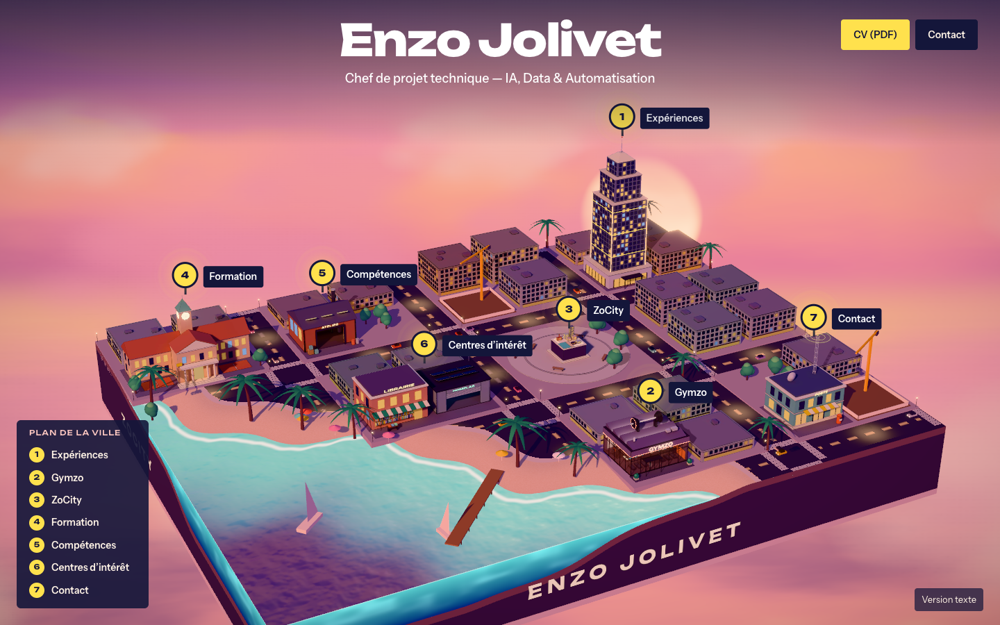
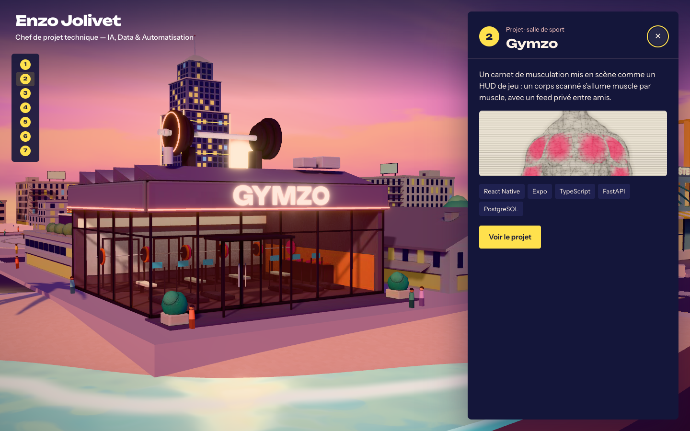
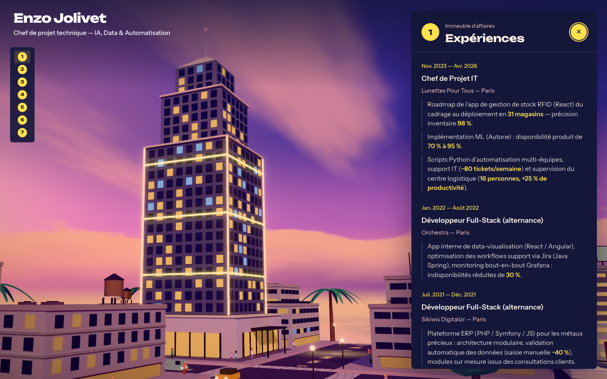

# ZoCity

**Démo live : [enzojolivet.com](https://enzojolivet.com)**

Mon portfolio est une ville miniature au crépuscule, posée sur un socle au-dessus d'une mer de nuages.
La caméra descend du ciel, puis chaque bâtiment ouvre une section : un marqueur numéroté dessus, un clic, et on
plonge au niveau de la rue.



| N° | Lieu                  | Section           |
| -- | --------------------- | ----------------- |
| 1  | Immeuble d'affaires   | Expériences       |
| 2  | Salle de sport        | Gymzo             |
| 3  | Maquette sur la place | ZoCity            |
| 4  | École                 | Formation         |
| 5  | Atelier               | Compétences       |
| 6  | Librairie et garage   | Centres d'intérêt |
| 7  | Bureau de poste       | Contact           |

| Au niveau de la rue, Gymzo…                         | …et l'immeuble d'affaires                                    |
| --------------------------------------------------- | ------------------------------------------------------------ |
|            |          |

## Stack

- React 19, Vite, TypeScript
- Three.js via React Three Fiber (`@react-three/drei`, `@react-three/postprocessing`), Zustand
- Blender piloté par script pour modéliser les bâtiments et cuire leur lumière dans des atlas
- `gltf-transform` pour la compression : les 8 modèles pèsent 2,2 Mo au total

## Développement

```bash
npm install
npm run dev     # http://localhost:3001
npm run build   # vérification des types et build de production
npm run lint    # ESLint
npm run bake    # reconstruit les modèles (Blender requis), ou : npm run bake -- gym tower
```

`/?skip` saute la descente, `/?texte` ouvre la version texte.

## Architecture

```
blender/
  lib.py            # matériaux, volumes, lumière du crépuscule, bake, export
  models/           # un script par modèle
scripts/bake-city.sh
src/
  city/
    places.ts       # le registre des lieux
    layout.ts       # blocs, lots, terrain, immeubles de fond, mobilier urbain
    buildings.tsx   # éléments vivants des bâtiments : enseignes, néons, animations
    models.ts       # chargement des modèles cuits
    Scene.tsx       # toile 3D, lumière, effets d'écran
    scene/          # socle et paysage, rues et circulation, lieux et marqueurs, caméra, préparation
    shaders.ts      # ciel, mer, sol, matériau des modèles cuits
  ui/               # titre, légende, panneaux, écran de chargement
  static/page.ts    # version texte, écrite dans le HTML au build
  data/content.ts   # contenu éditorial, source unique de la ville et de la version texte
```

### Ajouter un lieu

Une entrée dans `src/city/places.ts` suffit : elle réserve des lots sur la grille, et les immeubles de fond, le
marqueur, la légende, la caméra et le panneau suivent. La vue de rue est calculée à partir du terrain et de la
hauteur ; on ne la règle à la main que si un voisin gêne le cadre. Un projet occupe un lot comme n'importe quel immeuble : c'est
son style et son marqueur qui le distinguent, pas sa taille. Tous les modèles partagent la même échelle.

### Décisions notables

- **Lumière cuite.** Toute la lumière des bâtiments est dans leur texture, et seule l'ombre portée reste calculée en
  direct. Le rendu n'a donc pas besoin d'occlusion ambiante ni de flou en temps réel, les effets les plus coûteux à
  haute résolution.
- **Préparation derrière l'écran de chargement.** Modèles, polices, shaders, textures et premières images sont traités
  avant la descente, qui ne démarre qu'une fois les images fluides. Une machine lente passe en résolution inférieure à
  ce moment-là, là où le changement ne se voit pas.
- **Version texte pour tous les autres.** Moteurs de recherche, lecteurs d'écran, navigateurs sans WebGL ou sans
  JavaScript lisent une page écrite dans le HTML à partir des mêmes données. Elle prend aussi le relais si la ville
  échoue à se charger.
