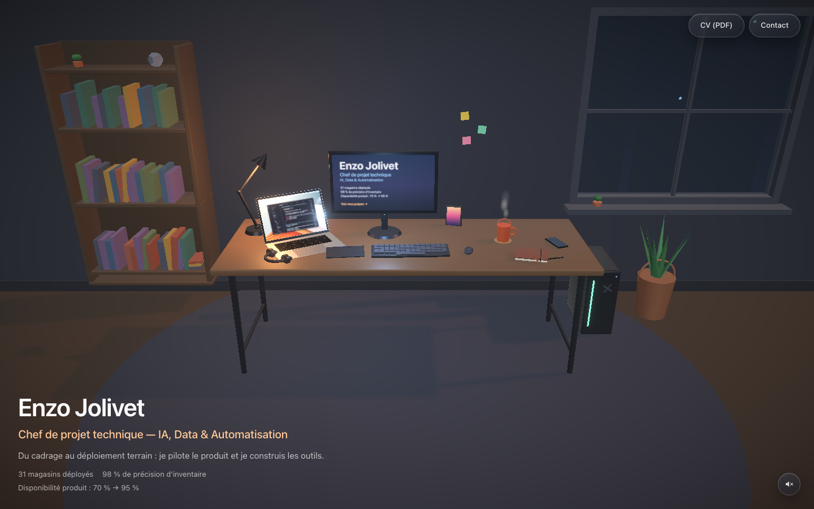
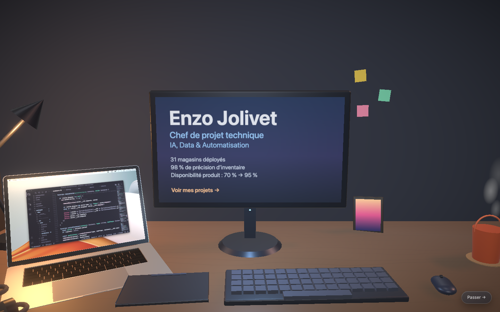
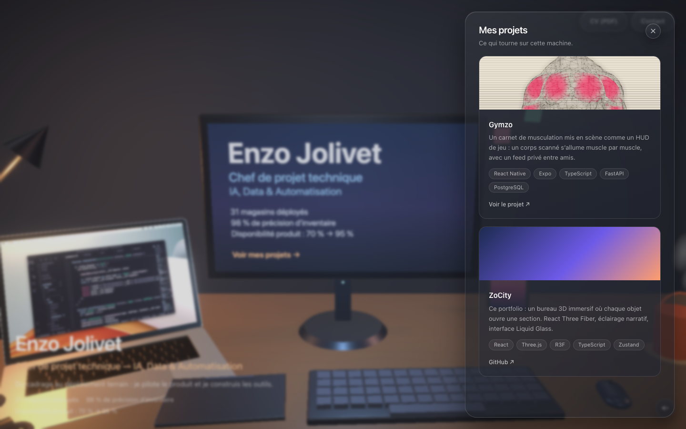

# ZoCity — Workspace

**🔴 Démo live : [enzojolivet.com](https://enzojolivet.com)**

Portfolio immersif : on n'arrive pas sur un site, on entre dans un bureau de
développeur en fin de journée. La caméra traverse la pièce, le PC s'allume sur
mon nom et mes résultats, puis chaque objet du bureau ouvre une section :



| Objet           | Section           |
| --------------- | ----------------- |
| Le PC           | Mes projets       |
| Le carnet       | Mon parcours      |
| La bibliothèque | Compétences       |
| Le téléphone    | Contact           |
| La fenêtre      | Mes réseaux       |
| La tasse        | Centres d'intérêt |

L'identité, le CV et le contact restent visibles en permanence. Pour le reste,
la lumière guide le regard (l'écran d'abord, puis un spot discret qui respire
sur le prochain objet non visité), les objets
vivent (vapeur du café, LED qui respire, plante qui oscille, notification du
téléphone), et le survol révèle une étiquette élégante.

| Le PC s'allume…                                | …et chaque objet ouvre un panneau                       |
| ---------------------------------------------- | ------------------------------------------------------- |
|  |  |

## Stack

- React 19 + Vite + TypeScript
- Three.js via React Three Fiber (`@react-three/drei`, `@react-three/postprocessing`)
- Zustand (état de l'expérience), Framer Motion (panneaux), Tailwind CSS v4
- Panneaux « Liquid Glass » en CSS pur (`backdrop-filter`) — pas de WebGL de
  réfraction, budget 60 FPS oblige
- Sons synthétisés en WebAudio (aucun asset audio), coupés par défaut

## Développement

```bash
npm install
npm run dev        # http://localhost:3001
npm run build      # type-check + build de production
```

## Architecture

```
src/
  components/
    scene/          # Canvas R3F : pièce, bureau, objets, lumières, caméra
      objects/      # un composant par objet (PC, tasse, carnet, téléphone…)
      lights/       # éclairage narratif + spot de guidage
      camera/       # rig 100 % contrôlé (intro, focus, parallaxe souris)
      effects/      # post-processing minimal (bloom + vignette)
    ui/             # HUD, curseur personnalisé
      panels/       # panneaux Liquid Glass (contenu HTML, jamais des textures)
  stores/           # Zustand : phase d'intro, focus, sections visitées, son
  data/             # contenu éditorial (projets, skills, timeline, contact)
  hooks/  utils/    # helpers (responsive, audio, textures canvas)
```

Décisions notables : géométrie procédurale (primitives Three.js), sauf le laptop
en GLTF compressé Draco, textures générées au runtime sur canvas, une seule
source d'ombres. Sur mobile, le post-processing est coupé et des chips donnent
accès aux sections que le cadrage portrait sort du champ.
